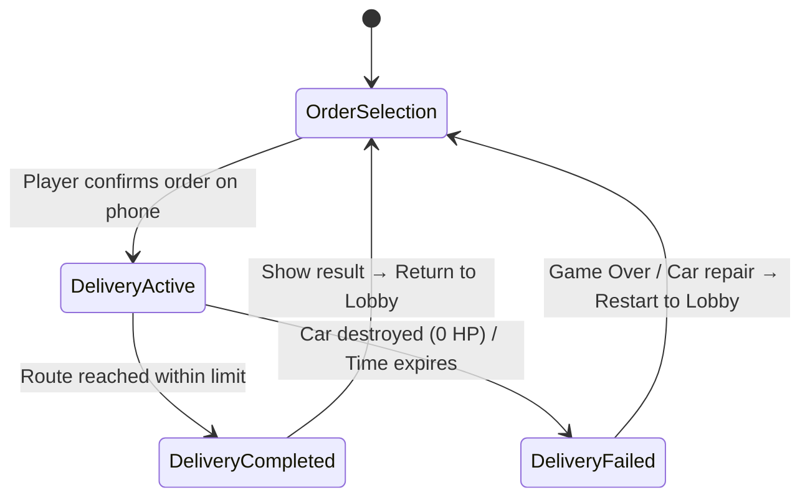

# AGENTS.md – DoomDriver: Project & Architectural Manual

> **Purpose of this document:** This file serves as permanent context, an architectural guide, and a binding reference point for all AI agents and human developers working on the **DoomDriver** project. Follow the principles and structure described here for every subsequent prompt and development step.

---

## 1. Project Overview & High Concept

* **Project name:** DoomDriver
* **Genre:** First‑Person Courier Simulation / Psychological Driving Hazard
* **Original state:** Endless runner with three lanes, score collection, and mobile scrolling.
* **New direction (Pivot):** Mission‑based courier loop (style *Bolt Food / Wolt*), where the driver battles a strong digital addiction to the phone (scrolling TikTok / Instagram Reels, FOMO syndrome) while driving through a city.

### Main gameplay loop:
1. **Lobby (Parking lot / Car interior):** The player sits in a parked car. On the phone screen they select from a list of available orders (varying in route length, reward, difficulty, and time limit).
2. **Active Delivery (DeliveryActive):**
   * The car accelerates onto the road. The world moves (`WorldMover`).
   * The player steers the car with smooth horizontal movement (no discrete lanes).
   * On the dashboard GPS display they follow navigation cues (distance to turn, left/right/straight).
   * **FOMO Distraction:** The FOMO meter constantly drops. To keep focus, the player must hold a key to raise the phone to their face and scroll short videos (reels). This reduces road visibility and GPS!
   * **Navigation decisions:** Missing a turn or steering incorrectly due to phone scrolling triggers *Recalculating*, extending the route and causing delays.
   * **Traffic & obstacles:** Avoid other cars, jams, and curbs. Car damage reduces the final reward.
3. **Evaluation (DeliveryCompleted / DeliveryFailed):**
   * After reaching the destination, the delivery is evaluated: base fee + speed tip – damage repair cost – penalties for missed turns.
   * Earned money is added to the player’s wallet (`Wallet`).
   * The player returns to the parked car lobby and selects the next order.

---

## 2. Architecture & Tech Stack

* **Engine & Render Pipeline:** Unity 2022.3+ / Unity 6, **Universal Render Pipeline (URP)**.
* **Input System:** Unity **New Input System** (`InputSystem_Actions`).
* **Text & UI:** **TextMeshPro (TMP)**, URP Post‑Processing Volumes (Vignette, Color Adjustments).
* **Video & Audio:** Unity VideoPlayer with RenderTextures for the phone screen, AudioSource for engine, collisions, GPS sounds, and reels audio.

### Directory structure (`Assets/_Game/`):
```
Assets/_Game/
├── Audio/                 # SFX for engine, collisions, GPS beeps, UI
├── Data/
│   ├── Input/             # InputSystem_Actions (.inputactions and generated C# class)
│   └── Orders/            # ScriptableObjects or order definitions
├── Materials/             # Interior, screen, road, obstacle materials
├── Models/                # 3D models (car cockpit, steering wheel, dashboard, city)
├── Prefabs/
│   ├── Cars/              # Traffic models (Ambulance, Police, Taxi, Car_1...)
│   ├── Core/              # GameManager, AudioManager
│   ├── Environment/       # Road segments (straight, intersection, T‑piece)
│   ├── Navigation/        # GPS display, navigation cues
│   ├── Obstacles/         # Cones, barriers, trash
│   ├── Phone/             # Hand with phone, courier app UI prefab
│   └── Player/            # Car interior, steering wheel, camera
├── Reels/                 # .mp4 videos and matching .mp3 tracks
├── RenderTextures/        # RenderTextures for phone and dashboard screens
├── Scenes/
│   ├── LoadingScreenMenu  # Main menu / loading scene
│   ├── EnviromentScene    # Main game scene (Lobby + Driving)
│   └── _Tests/            # Isolated test scenes
├── Scripts/
│   ├── Audio/             # AudioManager
│   ├── Core/              # GameManager, GameStateMachine, WorldMover, CameraShake
│   ├── Economy/           # DeliveryOrder, OrderManager, WalletManager
│   ├── Environment/       # EnvironmentSpawner, ChunkController, ObstacleSpawner, ObstacleData
│   ├── Navigation/        # NavigationManager, RouteController, TurnTrigger
│   ├── Phone/             # PhoneSystem, ReelsManager, HandController, CourierAppUI
│   ├── Player/            # PlayerController (analog steering, wheel, damage)
│   └── UI/                # DashboardNavigationUI, DeliverySummaryUI, UIHealthBar, LoadingScreen
└── Settings/              # URP assets, post‑process profiles
```

---

## 3. Game State Machine

The game loop is driven by a state machine in `GameManager` (or a dedicated `GameStateController`):


### Detailed state descriptions:
1. **`OrderSelection` (Lobby):**
   * Car is stationary (`WorldMover.moveSpeed = 0f`).
   * Engine idle sound plays.
   * Phone is held, showing the courier app.
   * 2‑3 random orders are generated with distance, reward, turn count, and time limit.
   * Clicking an order transitions to `DeliveryActive`.
2. **`DeliveryActive` (Driving):**
   * World starts moving (`WorldMover.moveSpeed` accelerates).
   * Phone hand lowers, phone switches to reels mode.
   * Navigation system generates the required number of straight sections and intersections based on the selected order.
   * Dashboard GPS guides the player.
   * FOMO meter drops; the player must balance road watching and phone scrolling.
   * Turns are detected, successful or missed.
3. **`DeliveryCompleted` (Success):**
   * Car smoothly stops in the target zone (`WorldMover.moveSpeed = 0f`).
   * Evaluation panel shows:
     * Base fee
     * Time tip
     * Damage repair penalties
     * Missed‑turn penalties
     * Net earnings
   * Money is added to the wallet.
   * Press “Continue” to return to `OrderSelection`.
4. **`DeliveryFailed` (Failure):**
   * Triggered by total car destruction (Health = 0) or critical time expiry.
   * Failure UI shows cancelled order and towing/repair fee.
   * Option to restart to `OrderSelection`.

---

## 4. Core Systems & Rules

### A. Smooth Horizontal Car Handling
* **Original:** Discrete lane switching (`targetLane = 0, 1, 2`).
* **New system:**
  * Continuous X‑axis movement driven by analog input (`controls.Player.Move.ReadValue<Vector2>().x`).
  * X position clamped between road margins (`minRoadX`, `maxRoadX`).
  * Steering speed (`steerSpeed`) reacts to key press duration or analog stick.
  * **Steering wheel rotation:** Wheel angle (`steeringWheel.localRotation`) mirrors current steering direction and intensity.
  * **Body roll & tilt:** Car body tilts opposite to the turn direction.
  * **Edge interaction:** Instead of destroying the car when leaving the lane, the car bounces off the curb – a soft bounce back, slight slowdown, and minor vibration.

### B. Phone & Reels System (FOMO Distraction)
* Phone has two primary modes:
  1. **OrderSelection:** UI showing the courier app for order picking.
  2. **DeliveryActive:** Video player streaming short reels via `VideoPlayer` and `RenderTexture`.
* **FOMO mechanic:**
  * `fomoValue` (0‑100). When not looking at the phone it drains at `drainRate`.
  * If FOMO drops below a critical threshold (e.g., <30%), aggressive post‑processing activates (vignette tunnel vision, desaturation, exposure loss).
  * Holding a key (Space / Jump) raises the hand with the phone (`HandController.SetRaised(true)`), camera FOV zooms from 60° to 40°.
  * While looking at the phone, `fomoValue` refills quickly (`refillRate`), video plays with sound – **the player cannot see the road or GPS**.

### C. Navigation & Turn System (GPS & Intersections)
* **Road network & intersections:** The `EnvironmentSpawner` inserts intersections (T‑junctions, 4‑way, curves) according to the active order profile.
* **Dashboard GPS UI:** Placed on the 3D dashboard (World Space Canvas or RenderTexture). Shows:
  * Arrow for the next maneuver (Left, Right, Straight).
  * Remaining distance to the turn in meters.
  * Audio cue (beep) ~50 m before the turn.
* **Turn handling & missed turns:**
  * Correct turn triggers route progression.
  * Missed turn triggers *Recalculating*, dynamically extending the route (+150 m) and applying time/financial penalties.

### D. Economy & Order System
* **Order data model (`DeliveryOrder`):**
  * `orderID` – unique identifier.
  * `restaurantName` & `customerName` – thematic names.
  * `totalDistance` – distance in meters.
  * `junctionCount` – number of turns and their sequence.
  * `timeLimit` – time limit for maximum tip.
  * `basePayout` – fixed delivery fee.
  * `maxTip` – variable tip decreasing over time.
* **Wallet (`WalletManager`):**
  * Stores total player funds.
  * Persistent storage via `PlayerPrefs` or encrypted JSON.
  * Emits `OnBalanceChanged(float newBalance)` events.

---

## 5. Coding Conventions & Best Practices

1. **Unity New Input System:** Always use the generated `InputSystem_Actions` class. No legacy `Input.GetKey()` or `Input.GetAxis()`.
2. **Encapsulation & Inspector:** Prefer `[SerializeField] private` over public fields unless external access is required. Expose data via C# properties.
3. **Performance & Update Cycle:**
   * **Never** call `GetComponent<T>()`, `FindObjectOfType<T>()`, or `GameObject.Find()` inside `Update()`, `FixedUpdate()`, or `LateUpdate()`. Cache references in `Awake()` or `Start()`.
   * Avoid allocating new strings each frame for UI text – update only when the value changes.
4. **Decoupled Architecture (Events):** Components communicate primarily through C# events (`System.Action`, `UnityEvent`). Example: `PlayerController` raises `OnHealthChanged?.Invoke(currentHealth)` instead of directly updating UI.
5. **`.meta` files & prefab‑first workflow:** Every new asset must be committed together with its `.meta` file. Never edit the main scene layout directly; create prefabs in `Assets/_Game/Prefabs/` and place those in scenes.
6. **Null safety & defensive programming:** Always check `if (GameManager.Instance == null)` before accessing globals. Verify references before using particle systems, audio, or textures.

---

## 6. Sprints & Project Management

Specific tasks for each sprint, team assignments, Trello cards, and acceptance criteria (Definition of Done) are archived and managed in the dedicated folder:
📁 **[`Docs/Sprints/`](../../Docs/Sprints/)**

The `AGENTS.md` file remains the permanent architectural manual valid across the entire development. Sprint tasks directly reference it.
