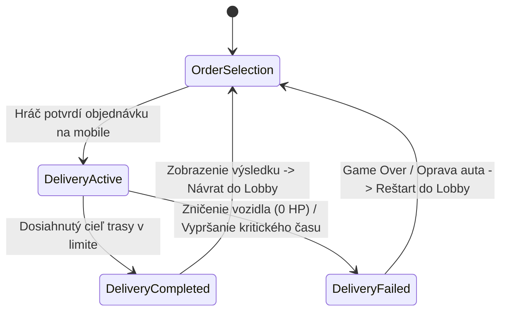

# AGENTS.md – DoomDriver: Projektový & Architektonický Manuál

> **Účel tohto dokumentu:** Tento súbor slúži ako trvalý kontext, architektonická príručka a záväzný referenčný bod pre všetkých AI agentov a ľudských vývojárov pracujúcich na projekte **DoomDriver**. Pri každom ďalšom prompte a vývojovom kroku sa riaďte princípmi a štruktúrou popísanou v tomto dokumente.

---

## 1. Project Overview & High Concept

* **Názov projektu:** DoomDriver
* **Žáner:** First-Person Courier Simulation / Psychological Driving Hazard
* **Pôvodný stav:** Endless runner v troch pruhoch so zbieraním skóre a scrollovaním mobilu.
* **Nový smer (Pivot):** Misijný herný loop donáškového kuriéra (štýl *Bolt Food / Wolt*), ktorý v kokpite auta bojuje so silnou digitálnou závislosťou na mobile (scrollovanie TikTok / Instagram Reels, FOMO syndróm) počas dynamickej jazdy mestom.

### Hlavný gameplay loop:
1. **Lobby (Parkovisko / Interiér auta):** Hráč sedí v zaparkovanom aute. Na displeji telefónu v kuriérskej aplikácii si vyberá zo zoznamu dostupných zákaziek (líšia sa dĺžkou trasy, odmenou, náročnosťou a časovým limitom).
2. **Aktívna donáška (DeliveryActive):**
   * Auto vyráža na cestu. Posun sveta beží (`WorldMover`).
   * Hráč riadi auto plynulým horizontálnym pohybom (bez diskrétnych pruhov).
   * Na palubnom GPS displeji sleduje navigačné pokyny (vzdialenosť k odbočke, smer vľavo / vpravo / rovno).
   * **FOMO Distrakcia:** Hráčovi neustále klesá FOMO meter. Aby nestratil pozornosť (vinetácia, rozostrenie, strata zmyslov), musí podržaním klávesu zdvihnúť mobil k tvári a scrollovať krátke videá (reels). Tým však stráca výhľad na cestu a GPS!
   * **Navigačné rozhodnutia:** Ak hráč prešvihne odbočku alebo zle zatočí kvôli pozeraniu do mobilu, GPS hlási *Recalculating*, trasa sa dynamicky predĺži o extra segmenty a hrozí meškanie.
   * **Premávka a prekážky:** Vyhýbanie sa autám, zátarasám a krajniciam. Poškodenie auta znižuje finálnu odmenu za opravy.
3. **Vyhodnotenie (DeliveryCompleted / DeliveryFailed):**
   * Po prejdení cieľového úseku sa donáška vyhodnotí: základná sadzba + prepitné za rýchlosť - zrážky za opravu poškodenia - penalizácie za zablúdenie.
   * Zarobené peniaze sa pripíšu do peňaženky hráča (`Wallet`).
   * Hráč sa vracia do zaparkovaného auta v Lobby a vyberá si ďalšiu objednávku.

---

## 2. Architecture & Tech Stack

* **Engine & Render Pipeline:** Unity 2022.3+ / Unity 6, **Universal Render Pipeline (URP)**.
* **Input System:** Unity **New Input System** (`InputSystem_Actions`).
* **Text & UI:** **TextMeshPro (TMP)**, URP Post-Processing Volumes (Vignette, Color Adjustments).
* **Video & Audio:** Unity VideoPlayer s RenderTextures pre mobilnú obrazovku, AudioSource pre motor, kolízie, GPS zvuky a ozvučenie reels videí.

### Adresárová štruktúra (`Assets/_Game/`):
```text
Assets/_Game/
├── Audio/                 # SFX zvuky motora, nárazov, GPS pípania, UI zvuky
├── Data/
│   ├── Input/             # InputSystem_Actions (.inputactions a vygenerovaná C# trieda)
│   └── Orders/            # ScriptableObjecty alebo definície objednávok
├── Materials/             # Materiály interiéru, displejov, ciest, prekážok
├── Models/                # 3D modely (kokpit auta, volant, palubovka, mesto)
├── Prefabs/
│   ├── Cars/              # Modely premávky (Ambulance, Police, Taxi, Car_1...)
│   ├── Core/              # GameManager, AudioManager
│   ├── Environment/       # Úseky cesty (rovné úseky, križovatky, T-kusy)
│   ├── Navigation/        # GPS displej na palubovke, smerové navigačné prvky
│   ├── Obstacles/         # Prekážky (kužele, barikády, smetiaky)
│   ├── Phone/             # Ruka s telefónom, UI prefab kuriérskej appky
│   └── Player/            # carInterior (kokpit hráča, volant, kamera)
├── Reels/                 # .mp4 videá a zodpovedajúce .mp3 stopy
├── RenderTextures/        # RenderTextúry pre obrazovku mobilu a palubovky
├── Scenes/
│   ├── LoadingScreenMenu  # Hlavné menu / načítavacia scéna
│   ├── EnviromentScene    # Hlavná herná scéna (Lobby + Jazda)
│   └── _Tests/            # Izolované testovacie scény
├── Scripts/
│   ├── Audio/             # AudioManager
│   ├── Core/              # GameManager, GameStateMachine, WorldMover, CameraShake
│   ├── Economy/           # DeliveryOrder, OrderManager, WalletManager
│   ├── Environment/       # EnvironmentSpawner, ChunkController, ObstacleSpawner, ObstacleData
│   ├── Navigation/        # NavigationManager, RouteController, TurnTrigger
│   ├── Phone/             # PhoneSystem, ReelsManager, HandController, CourierAppUI
│   ├── Player/            # PlayerController (analógové riadenie, volant, poškodenie)
│   └── UI/                # DashboardNavigationUI, DeliverySummaryUI, UIHealthBar, LoadingScreen
└── Settings/              # URP Assety, PostProcess profily
```

---

## 3. Game State Machine

Herný loop je riadený stavovým automatom v `GameManager` (alebo dedikovanom `GameStateController`):



### Podrobný popis stavov:
1. **`OrderSelection` (Lobby v aute):**
   * Auto stojí na parkovisku (`WorldMover.moveSpeed = 0f`).
   * Zvuk motora ide na voľnobeh (idle pitch).
   * Mobil je vytiahnutý v ruke, na displeji je otvorená aplikácia *FoodCourier*.
   * Generujú sa 2 až 3 náhodné ponuky zákaziek s detailmi (Vzdialenosť, Odmena, Počet odbočiek, Časový limit).
   * Po kliknutí na objednávku prebieha prechod do `DeliveryActive`.
2. **`DeliveryActive` (Samotná donáška):**
   * Svet sa začína pohybovať (`WorldMover.moveSpeed` akceleruje na cestovnú rýchlosť).
   * Ruka s mobilom sa spustí dole, na displeji mobilu sa prepína režim na sociálne siete (Reels/FOMO).
   * Spúšťa sa navigačný systém: trasa generuje požadovaný počet rovných úsekov a križovatiek podľa zvolenej zákazky.
   * Palubný displej (Dashboard GPS) naviguje hráča k cieľu.
   * FOMO meter klesá; hráč musí vyvažovať sledovanie cesty a scrollovanie mobilu.
   * Detegujú sa križovatky, úspešné odbočenia, zlé odbočenia a nárazy.
3. **`DeliveryCompleted` (Úspešné doručenie):**
   * Auto plynule zastaví v cieľovej zóne (`WorldMover.moveSpeed = 0f`).
   * Otvára sa panel vyhodnotenia objednávky:
     * Základná odmena (Base Fee).
     * Prepitné za ušetrený čas (On-time Tip).
     * Zrážky za zablúdenie / zlé odbočenia (Reroute Penalty).
     * Zrážky za poškodenie vozidla (Car Repair Cost).
     * Čistý zisk (Net Earnings).
   * Pripísanie sumy do peňaženky hráča (`WalletManager`).
   * Tlačidlo "Pokračovať" vráti hru do stavu `OrderSelection`.
4. **`DeliveryFailed` (Neúspešná donáška):**
   * Vyvolaná totálnym zničením vozidla (Health = 0) alebo fatálnym vypršaním času.
   * UI zlyhania: zrušená objednávka, poplatok za odťahovku/opravu.
   * Možnosť reštartu do `OrderSelection`.

---

## 4. Core Systems & Rules

### A. Plynulý horizontálny pohyb auta (Smooth Vehicle Handling)
* **Pôvodný stav:** Diskrétne prepínanie 3 pruhov (`targetLane = 0, 1, 2`).
* **Nový systém:**
  * Kontinuálny horizontálny pohyb na osi X riadený analógovým vstupom (`controls.Player.Move.ReadValue<Vector2>().x`).
  * Pozícia X je plynule limitovaná medzi mantinelmi cesty (`minRoadX`, `maxRoadX`).
  * Rýchlosť zatáčania (`steerSpeed`) reaguje na dĺžku stlačenia klávesu / analógovej páčky.
  * **Rotácia volantu:** Uhol volantu (`steeringWheel.localRotation`) presne kopíruje aktuálny smer a intenzitu zatáčania.
  * **Body Roll & Tilt:** Karoséria auta sa pri dynamickom prechádzaní zákrut a zmene smeru mierne nakláňa proti smeru manévru.
  * **Interakcia s krajnicou:** Namiesto zničenia pri vybočení z pruhu hráč narazí na obrubník/mantinel – dôjde k jemnému odrazeniu (soft bounce back), spomaleniu a drobnému poškodeniu / vibrovaniu kamery.

### B. Mobil & Reels systém (FOMO Distrakcia)
* Mobil má dva primárne režimy podľa stavu hry:
  1. *V stave `OrderSelection`:* UI obrazovka s kuriérskou aplikáciou pre výber zákazky.
  2. *V stave `DeliveryActive`:* Video prehrávač streamujúci krátke videá (Reels / TikTok brainrot) cez `VideoPlayer` a `RenderTexture`.
* **FOMO mechanika:**
  * `fomoValue` (0 – 100). Pri nesledovaní mobilu klesá rýchlosťou `drainRate`.
  * Ak FOMO klesne pod kritickú hranicu (napr. < 30%), aktivuje sa agresívny post-processing (Vignette tunelové videnie, Color Adjustments desaturácia a úbytok expozície).
  * Držaním klávesu (Space / Jump) hráč zdvihne ruku s mobilom pred oči (`HandController.SetRaised(true)`), kamera zoomuje na mobil (`FOV` prechod z 60° na 40°).
  * Kým hráč pozerá do mobilu, `fomoValue` sa rýchlo dopĺňa (`refillRate`), video hrá aj so zvukom – **hráč však nevidí na cestu pred seba ani na navigačný displej palubovky!**

### C. Navigačný a Odbočovací systém (GPS & Križovatky)
* **Cestná sieť & Križovatky:**
  * Cesta nie je len nekonečná rovinka. Generátor (`EnvironmentSpawner`) do trasy zaradí križovatky (T-križovatky, 4-ramenné križovatky, zákruty) podľa profilu aktívnej objednávky.
  * Každá križovatka obsahuje `TurnTrigger`, ktorý vyhodnocuje pozíciu vozidla v momente prechodu.
* **Palubná navigácia (Dashboard GPS UI):**
  * Umiestnená priamo na 3D modeli palubovky pred volantom (World Space Canvas alebo RenderTexture).
  * Zobrazuje:
    * Smerovú šípku najbližšieho manévru (Vľavo, Vpravo, Priamo).
    * Zostávajúcu vzdialenosť k odbočke v metroch (napr. *120 m*).
    * Zvukový signál (pípnutie) pri blížiacom sa manévri (*50 m* pred križovatkou).
* **Mechanika odbočenia & Zablúdenia:**
  * Hráč musí v priestore križovatky natočiť vozidlo do správneho smeru (napr. držať auto na ľavej strane a točiť doľava).
  * **Správne odbočenie:** Manéver splnený, svet pokračuje novým priamym úsekom, navigácia preskočí na ďalší bod trasy.
  * **Zlé odbočenie alebo prešvihnutie (Missed Turn):** Nastáva, ak hráč ignoruje pokyn alebo kvôli pozeraniu do mobilu nestihne zareagovať.
    * Hlasový/zvukový efekt *„Prepočítavam trasu...“ (Recalculating)*.
    * Dynamické predĺženie trasy: systém pridá dodatočné úseky cesty (napr. +150 m zachádzka).
    * Strata času a finančná penalizácia za meškanie.

### D. Ekonomika a Objednávkový systém (Economy & Orders)
* **Dátový model zákazky (`DeliveryOrder`):**
  * `orderID`: Unikátny identifikátor.
  * `restaurantName` & `customerName`: Tematické názvy (napr. *Burger Palace -> Študentský internát*).
  * `totalDistance`: Celková vzdialenosť v metroch.
  * `junctionCount`: Počet križovatiek a sekvencia odbočiek.
  * `timeLimit`: Časový limit pre dosiahnutie maximálneho prepitného.
  * `basePayout`: Pevná odmena za doručenie (napr. 15.00 €).
  * `maxTip`: Variabilné prepitné klesajúce s ubiehajúcim časom.
* **Peňaženka (`WalletManager`):**
  * Ukladá celkový stav financií kuriéra.
  * Trvalé ukladanie do `PlayerPrefs` alebo šifrovaného JSON.
  * Poskytuje eventy `OnBalanceChanged(float newBalance)`.

---

## 5. Coding Conventions & Best Practices

AI agenti aj členovia tímu **musia** rešpektovať nasledujúce konvencie pri písaní kódu:

1. **Unity New Input System:** Vždy používať triedu `InputSystem_Actions`. Žiadny starý `Input.GetKey()` alebo `Input.GetAxis()`.
2. **Zapuzdrenie & Inšpektor:**
   * Preferujte `[SerializeField] private` pred verejnými `public` premennými, pokiaľ premenná nemá byť menená z iných tried.
   * Verejné dáta vystavujte pomocou C# Properties (napr. `public float MoveSpeed => moveSpeed;`).
3. **Výkon & Update Cyklus:**
   * **Nikdy** nevolať `GetComponent<T>()`, `FindObjectOfType<T>()` ani `GameObject.Find()` v metódach `Update()`, `FixedUpdate()` alebo `LateUpdate()`. Všetky referencie inicializujte v `Awake()` alebo `Start()`.
   * Pri práci s reťazcami a textom v UI nealokujte zbytočne stringy každý frame – aktualizujte text len vtedy, keď sa hodnota reálne zmení.
4. **Voľná väzba (Decoupled Architecture cez Eventy):**
   * Komponenty medzi sebou komunikujú primárne cez C# eventy a akcie (`System.Action`, `UnityEvent`).
   * Príklad: `PlayerController` nezapisuje priamo do UI skriptu, ale vyvolá `OnHealthChanged?.Invoke(currentHealth)`.
5. **Pravidlá pre `.meta` súbory a prefab-first prístup:**
   * Každý nový skript, textúra, model alebo prefab musí byť commitnutý **spolu so svojím `.meta` súborom**.
   * Nikdy neupravujte layout hlavnej scény priamo, ak môžete vytvoriť a použiť Prefab v `Assets/_Game/Prefabs/`. Tým predchádzame neriešiteľným merge konfliktom v Git.
6. **Ošetrovanie stavov (Null Safety & Defensive Programming):**
   * Vždy kontrolujte `if (GameManager.Instance == null)` pred volaním globálneho stavu.
   * Pri práci s časticovými efektmi, zvukmi a textúrami overte existenciu referencie pred spustením.

---

## 6. Sprinty & Projektový manažment

Konkrétne úlohy pre jednotlivé šprinty, rozdelenie práce medzi členov tímu, Trello kartičky a akceptačné kritériá (Definition of Done) sú archivované a spravované v dedikovanom priečinku:
📁 **[`Docs/Sprints/`](file:///c:/Users/jakub/OneDrive/Počítač/2627/TP/DoomDriver/Docs/Sprints/)**

Tento súbor `AGENTS.md` ostáva trvalým architektonickým manuálom platným naprieč celým vývojom. Úlohy v šprintoch naň priamo nadväzujú.

