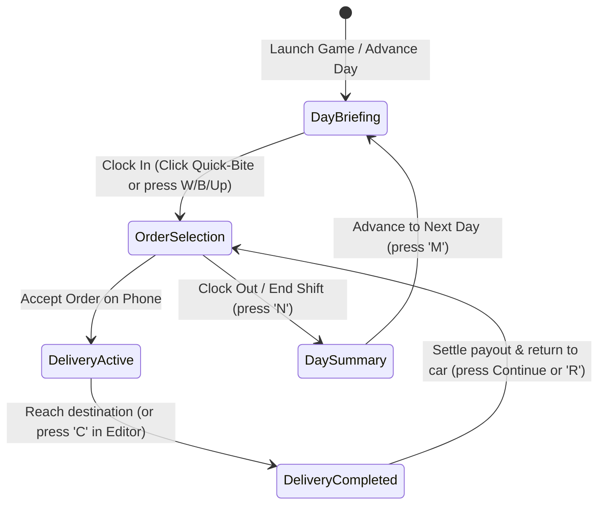

# DoomDriver – Shift Lifecycle Testing & Verification Guide

> **Target Audience:** Developers, QA testers, and AI agents.  
> **Status:** Active & fully functional in code and Unity scenes.  
> **Related Architecture Document:** [`Docs/WORKDAY_LIFECYCLE_GUIDE.md`](./WORKDAY_LIFECYCLE_GUIDE.md)

---

## 1. Overview of the Shift Lifecycle

The shift lifecycle system models the daily work of a courier across multiple delivery runs, daily quotas, overtime incentives, and day settlements.



---

## 2. Interactive In-Game Flow

1. **Morning Dispatch (`DayBriefing`):**
   * The player sits in the parked car at the start of the morning.
   * Phone opens to the **Home Screen**, showing today's day count and target quota (e.g. `DAY 1 • GOAL: 0/3 ORDERS`).
   * Clicking the **Quick-Bite** courier app icon automatically clocks the player in, starts the shift, and switches to `OrderSelection`.

2. **Active Shift & Taking Orders (`OrderSelection` ↔ `DeliveryActive`):**
   * The **Courier App** opens showing available restaurant orders.
   * Player selects an offer to drive (`DeliveryActive`).
   * Dashboard GPS directs the route while FOMO phone videos drain attention.
   * Finishing the delivery transitions to `DeliveryCompleted` and shows `DeliverySummaryUI`.
   * Pressing "Continue" returns to the car lobby, settles net earnings to the wallet, and increments `DeliveriesCompletedToday`.

3. **Quota & Overtime:**
   * Once `DeliveriesCompletedToday >= DailyQuota`, `ShiftManager.OnShiftCompleted` fires and unlocks **Overtime Mode**.
   * Any further deliveries in the same day earn a **+25% Speed Tip bonus**.
   * The top header changes to `Quota Met: X / Y Orders (Overtime)`.

4. **Ending the Shift & Next Day (`DaySummary` → `DayBriefing`):**
   * Player clocks out (or presses `N` in Editor), ending the shift (`ShiftManager.EndShift()`).
   * State transitions to `DaySummary` for net settlement.
   * Player starts the next day (or presses `M` in Editor):
     * Day increments (`Day 1 → Day 2`).
     * Target quota scales up according to day index.
     * Daily delivery count and shift earnings reset to 0.
     * New `DayBriefing` begins.

---

## 3. Fast Debug Keyboard Shortcuts (Unity Editor)

When testing inside the Unity Editor, the following keyboard shortcuts in `GameManager.cs` let you test the entire lifecycle in seconds:

| Key | Context / State | Action Performed | Console Log |
| :--- | :--- | :--- | :--- |
| **`W` / `B` / `Up Arrow`** | `DayBriefing` | Starts shift immediately & opens Courier App | `[GameManager] Up Arrow / W / B pressed -> Starting Shift...` |
| **`C`** | `DeliveryActive` | Instantly completes active delivery | `[DEBUG] C pressed -> Completing Delivery!` |
| **`R`** | `DeliveryCompleted` / `Failed` | Returns to lobby, pays out wallet & records order in `ShiftManager` | `[DEBUG] R pressed -> Returning to Order Selection Lobby!` |
| **`N`** | `OrderSelection` / `DeliveryCompleted` | Clocks out & ends shift to `DaySummary` | `[DEBUG] N pressed -> Ending Shift to DaySummary!` |
| **`M`** | `DaySummary` | Advances to Next Day (`Day + 1`, reset counters) | `[DEBUG] M pressed -> Advancing to Next Day!` |
| **`U`** | Any | Resets career progress to Day 1 defaults (0 orders, €0) | `[DEBUG] U pressed -> Resetting Career to Day 1!` |

---

## 4. Console Log Reference

All lifecycle scripts output color-coded log entries to the Unity Console for real-time monitoring:

### 1. Initialization (`ShiftManager.Awake`):
```
[ShiftManager] 🚀 Loaded Progress -> Day 1 | Quota: 3 | Delivered Today: 0 | Career Deliveries: 0 | Shift Active: False | Earnings: €0.00
[GameManager] 🔄 Game state changed to: DayBriefing (Day 1 • 0/3 orders • ShiftActive: False)
[PhoneOSController] 🌅 DayBriefing started -> Showing Phone Home Screen
```

### 2. Clock In / Shift Start:
```
[PhoneOSController] 📱 Switching screen to: CourierApp
[PhoneOSController] Opening Courier App during DayBriefing -> Starting Shift!
[ShiftManager] ⏰ SHIFT STARTED for Day 1! Target Quota: 3 deliveries. Clocked In.
[GameManager] 🔄 Game state changed to: OrderSelection (Day 1 • 0/3 orders • ShiftActive: True)
[CourierAppUI] 📋 Refreshed Header -> Day 1 • Orders: 0/3 (QuotaMet: False)
```

### 3. Delivery Completed & Payout:
```
[GameManager] 🔄 Game state changed to: DeliveryCompleted (Day 1 • 0/3 orders • ShiftActive: True)
[GameManager] 💰 Delivery payout settled: +€18.50. New Wallet Balance: €518.50
[ShiftManager] 📦 DELIVERY COMPLETED! Today: 1/3 (2 more needed) | Payout: +€18.50 | Shift Total: €18.50
[GameManager] 🔄 Game state changed to: OrderSelection (Day 1 • 1/3 orders • ShiftActive: True)
[CourierAppUI] 📋 Refreshed Header -> Day 1 • Orders: 1/3 (QuotaMet: False)
```

### 4. Daily Quota Achieved:
```
[ShiftManager] 📦 DELIVERY COMPLETED! Today: 3/3 🏆 QUOTA MET - OVERTIME ACTIVE (+25% Speed Tip) | Payout: +€22.00 | Shift Total: €65.00
[ShiftManager] 🏆 DAILY QUOTA ACHIEVED (3/3)! Overtime mode unlocked (+25% tip). Player can continue delivering or End Shift.
```

### 5. Clock Out / End Shift:
```
[ShiftManager] 🏁 SHIFT ENDED for Day 1. Finished 3 orders today with €65.00 earned. Proceeding to DaySummary settlement.
[GameManager] 🔄 Game state changed to: DaySummary (Day 1 • 3/3 orders • ShiftActive: False)
```

### 6. Advance to Next Day:
```
[ShiftManager] ☀️ ADVANCED TO NEXT DAY: Day 2. New target quota: 4 orders. Daily counters reset to 0.
[GameManager] 🔄 Game state changed to: DayBriefing (Day 2 • 0/4 orders • ShiftActive: False)
[PhoneOSController] 🌅 DayBriefing started -> Showing Phone Home Screen
```

---

## 5. Persistence & PlayerPrefs Keys

All career progress is automatically saved to `PlayerPrefs` at every transition:
* `DoomDriver_CurrentDay`: Current day index (`int`).
* `DoomDriver_DeliveriesToday`: Orders completed today (`int`).
* `DoomDriver_DailyQuota`: Daily target quota (`int`).
* `DoomDriver_CareerDeliveries`: Lifetime orders completed (`int`).
* `DoomDriver_ShiftEarnings`: Accumulated gross shift earnings (`float`).
* `DoomDriver_IsShiftActive`: Working status (`0` or `1`).

To reset career stats during testing, press **`U`** in Editor or call `ShiftManager.Instance.ResetCareer()`.
