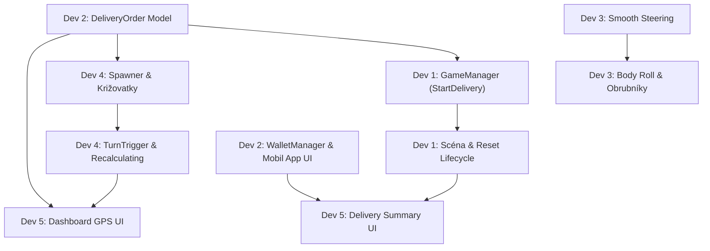

# Sprint 01 – Pivot: Courier Mission Loop (Bolt Food Style)

> **Cieľ šprintu (Sprint Goal):**
> Transformovať pôvodný endless runner s fixnými 3 pruhmi na misijný herný cyklus donáškového kuriéra. Hráč začína v zaparkovanom aute (Lobby), v kuriérskej appke si vyberie objednávku, absolvuje trasu podľa palubného GPS displeja pri neustálom balanse s mobilnými Reels (FOMO meter), zvládne odbočenia na križovatkách a po dojazde dostane finančné vyhodnotenie do svojej peňaženky.

---

## 👥 Zloženie tímu & Zodpovednosti

| Rola | Vývojár | Primárna zodpovednosť v šprinte |
| :--- | :--- | :--- |
| **Dev 1** | Game Flow & State Machine | Stavový automat (`GameManager`), životný cyklus donášky, orchestrácia a resetovanie scény. |
| **Dev 2** | Orders & Economy | Dátový model `DeliveryOrder`, procedurálny `OrderManager`, správa peňazí `WalletManager` a UI appky v mobile. |
| **Dev 3** | Vehicle Dynamics & Physics | Plynulé riadenie po šírke cesty (odstránenie pruhov), realistický volant, náklon auta (tilt) a elastický kontakt s krajnicami. |
| **Dev 4** | Road Network & Navigation Backend | Generovanie križovatiek v `EnvironmentSpawner`, komponent `TurnTrigger`, validácia odbočiek a prepočet trasy (*Recalculating*). |
| **Dev 5** | Dashboard UI & Final Evaluation | Palubná GPS navigácia na palubovke auta s audio pípnutím, a záverečné sumárne UI vyhodnotenia objednávky. |

---

## 🔗 Matica závislostí (Task Dependencies)

---

## 📋 Detailný rozpis Trello kartičiek

---

### 👤 DEV 1: Game Flow & State Machine

#### Kartička 1.1: Implementácia stavového automatu hry (Game State Machine)
* **Názov:** `[DEV 1] Implementácia Game State Machine (OrderSelection -> DeliveryActive -> Completed / Failed)`
* **Popis & Rozsah úlohy (Scope):**
  * Nahradiť pôvodný jednoduchý boolean `isGameOver` komplexným stavovým automatom riadiacim celý misijný cyklus donášky.
  * Definovať herné stavy:
    * `OrderSelection`: Auto stojí (`WorldMover.moveSpeed = 0f`), motor ide na voľnobeh, mobil je v ruke s ponukou zákaziek.
    * `DeliveryActive`: Auto vyráža, svet sa pohybuje, beží časovač objednávky, aktivujú sa križovatky, prekážky a FOMO drain.
    * `DeliveryCompleted`: Cieľ dosiahnutý v limite, svet plynule zastavuje, vyvoláva sa vyhodnotenie a zárobok.
    * `DeliveryFailed`: Zničenie vozidla (0 HP) alebo fatálne vypršanie času, Game Over / nutnosť opravy.
  * Zabezpečiť C# udalosti pre prechody stavov (`OnGameStateChanged`, `OnDeliveryStarted`, `OnDeliveryFinished`), na ktoré sa napoja ostatné systémy (UI, Audio, Spawner).
* **Kľúčové súbory / komponenty:**
  * Upraviť: `Assets/_Game/Scripts/Core/GameManager.cs`
  * Vytvoriť: `Assets/_Game/Scripts/Core/GameState.cs` (alebo enum v `GameManager.cs`)
  * Upraviť: `Assets/_Game/Scripts/Core/WorldMover.cs`
* **Definition of Done (Akceptačné kritériá):**
  * Hra sa v scéne `EnviromentScene` naštartuje v stave `OrderSelection` (auto stojí, žiadny nekonečný spawn prekážok).
  * Zavolanie `GameManager.Instance.StartDelivery(selectedOrder)` plynule zrýchli svet, spustí časovač a ohlási štart donášky.
  * Ukončenie donášky cez `CompleteDelivery()` alebo `FailDelivery()` zastaví pohyb sveta a korektne notifikuje subsystémy.
  * Hra umožňuje návrat späť do `OrderSelection` bez nutnosti znovunačítania celej Unity scény cez `SceneManager.LoadScene`.

#### Kartička 1.2: Životný cyklus donášky a orchestrácia scény
* **Názov:** `[DEV 1] Životný cyklus donášky, resetovanie stavu a orchestrácia scény`
* **Popis & Rozsah úlohy (Scope):**
  * Zabezpečiť čistý reštart a vyčistenie scény medzi jednotlivými donáškami (vynulovanie prejdenej vzdialenosti, reset dočasného poškodenia auta, odstránenie starých prekážok, zachovanie peňaženky).
  * Upraviť ESC pauzu (`TogglePause`), aby korektne fungovala v novom stave donášky (zastavenie časovača donášky, zmrazenie `Time.timeScale`, stíšenie audia).
  * Prepojiť zvukové stavy motora (idle zvuk v zaparkovanom aute, akcelerácia pri začiatku donášky).
* **Kľúčové súbory / komponenty:**
  * Upraviť: `Assets/_Game/Scripts/Core/GameManager.cs`
  * Upraviť: `Assets/_Game/Scripts/Player/PlayerController.cs` (pridať metódu `ResetVehicleState()`)
  * Upraviť: `Assets/_Game/Scripts/Audio/AudioManager.cs`
* **Definition of Done (Akceptačné kritériá):**
  * Pri prechode medzi donáškami nedochádza k hromadeniu starých objektov v scéne (žiadny memory leak).
  * Zdravie auta sa pri novej zákazke resetuje na maximum (alebo podľa financií hráča), pričom zostatok v peňaženke ostáva zachovaný.
  * ESC pauza spoľahlivo funguje počas jazdy bez rozbitia časovačov objednávky.

---

### 👤 DEV 2: Objednávkový systém & Peňaženka / Ekonomika

#### Kartička 2.1: Dátový model zákaziek a procedurálny generátor ponúk
* **Názov:** `[DEV 2] Dátový model zákaziek a procedurálny generátor ponúk (Order System)`
* **Popis & Rozsah úlohy (Scope):**
  * Vytvoriť dátový model `DeliveryOrder` reprezentujúci donášku:
    * Názov reštaurácie a zákazníka (napr. *Burger Palace -> Študentský domov*).
    * Celková vzdialenosť v metroch (napr. 400 m až 1200 m).
    * Časový limit pre doručenie (Time Limit).
    * Sekvencia požadovaných odbočiek na trase (napr. *Vľavo, Rovno, Vpravo*).
    * Základná finančná odmena (Base Payout) a maximálne prepitné (Max Tip).
  * Implementovať `OrderManager`, ktorý pri vstupe do stavu `OrderSelection` vygeneruje 3 odlišné ponuky (ľahká krátka, stredná, dlhá lukratívna).
* **Kľúčové súbory / komponenty:**
  * Vytvoriť: `Assets/_Game/Scripts/Economy/DeliveryOrder.cs`
  * Vytvoriť: `Assets/_Game/Scripts/Economy/OrderManager.cs`
  * Vytvoriť: Dátové šablóny pre názvy v `Assets/_Game/Data/Orders/`
* **Definition of Done (Akceptačné kritériá):**
  * Pri každom návrate do `OrderSelection` systém vygeneruje 3 unikátne ponuky s vyváženým pomerom dĺžky, náročnosti a finančnej odmeny.
  * Zvolená objednávka je prístupná cez `OrderManager.CurrentOrder` a poskytuje potrebné navigačné a časové dáta pre ostatné skripty.

#### Kartička 2.2: Peňaženka kuriéra a UI aplikácie na mobile v aute
* **Názov:** `[DEV 2] Správa peňazí (WalletManager) a UI kuriérskej aplikácie v telefóne`
* **Popis & Rozsah úlohy (Scope):**
  * Vytvoriť `WalletManager` na uchovávanie stavu financií hráča s trvalým ukladaním cez `PlayerPrefs`.
  * Vytvoriť UI skript `CourierAppUI` pre displej mobilu v interiéri vozidla.
  * V stave `OrderSelection` zobraziť v telefóne rozhranie kuriérskej appky: zoznam 3 vygenerovaných ponúk, detaily zákazky, aktuálny stav peňaženky a tlačidlo "Prijať zákazku".
  * Po kliknutí na tlačidlo odovzdať vybranú zákazku do `GameManager.Instance.StartDelivery(order)`.
  * Prepojiť `PhoneSystem` tak, aby sa v `OrderSelection` zobrazovala appka a počas `DeliveryActive` prepol mobil na reelskový systém.
* **Kľúčové súbory / komponenty:**
  * Vytvoriť: `Assets/_Game/Scripts/Economy/WalletManager.cs`
  * Vytvoriť: `Assets/_Game/Scripts/Phone/CourierAppUI.cs`
  * Upraviť: `Assets/_Game/Scripts/Phone/PhoneSystem.cs`
  * Upraviť prefab telefónu v: `Assets/_Game/Prefabs/Player/carInterior.prefab`
* **Definition of Done (Akceptačné kritériá):**
  * V mobile v stave `OrderSelection` hráč vidí interaktívne karty objednávok s ich cenami a parametrami.
  * Kliknutie na objednávku ju označí a tlačidlom "Prijať" sa spustí jazda.
  * Celkový stav peňaženky sa správne zobrazuje a po reštarte hry hodnota peňazí zostáva uložená.

---

### 👤 DEV 3: Pohyb vozidla & Fyzika riadenia

#### Kartička 3.1: Kontinuálne analógové riadenie a synchronizácia volantu
* **Názov:** `[DEV 3] Plynulý horizontálny pohyb auta a realistická rotácia volantu`
* **Popis & Rozsah úlohy (Scope):**
  * Odstrániť pôvodnú diskrétnu logiku prepínania 3 fixných pruhov (`targetLane = 0, 1, 2`).
  * Implementovať plynulý analógový pohyb vozidla na osi X riadený New Input Systemom (`controls.Player.Move.ReadValue<Vector2>().x`).
  * Nastaviť plynulú horizontálnu akceleráciu/zotrvačnosť a striktné mantinely šírky vozovky (`minRoadX`, `maxRoadX`).
  * Prepracovať rotáciu volantu v modeli interiéru (`steeringWheel.localRotation`), aby jeho uhol kontinuálne a plynulo reflektoval aktuálny vstup a natočenie kolies.
* **Kľúčové súbory / komponenty:**
  * Upraviť: `Assets/_Game/Scripts/Player/PlayerController.cs`
  * Overiť bindingy v: `Assets/_Game/Data/Input/InputSystem_Actions.inputactions`
  * Prefab: `Assets/_Game/Prefabs/Player/carInterior.prefab`
* **Definition of Done (Akceptačné kritériá):**
  * Auto sa pohybuje po celej šírke vozovky voľne a plynule bez skákania medzi 3 preddefinovanými čiarami.
  * Riadenie funguje rovnako prirodzene na klávesnici (A/D, šípky) aj na analógovom gamepade.
  * Volant sa točí proporcionálne k vstupu v rozsahu `[-maxSteeringAngle, maxSteeringAngle]` a pri uvoľnení klávesu sa plynule vráti do neutrálnej polohy.

#### Kartička 3.2: Náklon karosérie (Body Roll), zvukový feedback a kontakt s krajnicami
* **Názov:** `[DEV 3] Fyzikálny náklon auta (Tilt), pískanie gum a elastické odrazy od obrubníkov`
* **Popis & Rozsah úlohy (Scope):**
  * Prepočítať dynamický náklon vozidla (tilt / body roll) tak, aby reagoval na okamžité laterálne zrýchlenie pri prudkých manévroch.
  * Nahradiť zničujúci náraz do krajnice mechanikou mäkkého kontaktu (soft bounce back): pri dosiahnutí mantinelu cesty auto jemne odskočí späť, dôjde k drobnému zatraseniu kamery (`CameraShake`), miernemu spomaleniu rýchlosti sveta a zvuku trenia pneumatík.
  * Zosúladiť pískanie gúm (`screechSource`) tak, aby sa spúšťalo iba pri ostrom vytočení volantu vo vysokej rýchlosti.
* **Kľúčové súbory / komponenty:**
  * Upraviť: `Assets/_Game/Scripts/Player/PlayerController.cs`
  * Upraviť: `Assets/_Game/Scripts/Core/CameraShake.cs`
  * Zvukové zdroje na prefabu: `Assets/_Game/Prefabs/Player/carInterior.prefab`
* **Definition of Done (Akceptačné kritériá):**
  * Karoséria auta sa v zákrutách a pri manévroch prirodzene nakláňa.
  * Hráč nemôže prejsť cez okraj cesty – pri dotyku s obrubníkom pocíti jemný spätný ráz a zvukový efekt namiesto okamžitého záseku.
  * Jazda pôsobí plynulo, arkádovo a má dobrý fyzikálny feedback pri rýchlostiach od 12 do 30 m/s.

---

### 👤 DEV 4: Cestná sieť, Križovatky & Dynamické predlžovanie trasy

#### Kartička 4.1: Systém generovania križovatiek v EnvironmentSpawner
* **Názov:** `[DEV 4] Procedurálne generovanie križovatiek a sekvencie segmentov trasy`
* **Popis & Rozsah úlohy (Scope):**
  * Rozšíriť `EnvironmentSpawner` z nekonečnej roviny na generovanie trás podľa profilu zákazky z `DeliveryOrder`.
  * Vytvoriť nové prefabrykované úseky ciest s križovatkami:
    * Odbočka doľava (Left Turn Chunk).
    * Odbočka doprava (Right Turn Chunk).
    * T-križovatka / Priamy prejazd.
  * Zabezpečiť, aby spawner umiestnil križovatku presne v naplánovanej vzdialenosti podľa trasy objednávky.
* **Kľúčové súbory / komponenty:**
  * Upraviť: `Assets/_Game/Scripts/Environment/EnvironmentSpawner.cs`
  * Vytvoriť: `Assets/_Game/Scripts/Environment/RoadChunk.cs` (typ segmentu: Straight, TurnLeft, TurnRight)
  * Vytvoriť prefaby v: `Assets/_Game/Prefabs/Environment/` (s využitím modelov z `ThirdParty/Low Poly Simple Urban City 3D Asset Pack`)
* **Definition of Done (Akceptačné kritériá):**
  * `EnvironmentSpawner` dokáže na základe inštrukcií z objednávky plynule vsunúť križovatkový diel medzi rovné úseky.
  * Všetky segmenty na seba vizuálne nadväzujú bez škár, prepadov a kolíznych anomálií.
  * Pohyb križovatiek pomocou `WorldMover` a ich následný despawn za hráčom funguje rovnako spoľahlivo ako pri rovných úsekoch.

#### Kartička 4.2: Detekcia odbočenia a dynamický prepočet trasy (Recalculating)
* **Názov:** `[DEV 4] Validácia prejazdu križovatkou a dynamické predĺženie trasy pri zablúdení`
* **Popis & Rozsah úlohy (Scope):**
  * Vytvoriť komponent `TurnTrigger` umiestnený na prefaboch križovatiek.
  * Pri prejazde auta triggerom skontrolovať polohu auta na osi X a natočenie volantu:
    * *Správne odbočenie:* Hráč dodržal pokyn GPS (napr. bol v ľavej časti a zatočil doľava) -> manéver je úspešný, navigácia prechádza na ďalší bod.
    * *Zlé odbočenie / Zmeškanie:* Hráč prešvihol križovatku (napr. scrolloval mobil a išiel rovno) -> aktivácia stavu `Recalculating`.
  * Pri stave `Recalculating`:
    * Spustiť udalosť `OnMissedTurn`.
    * Dynamicky pridať do frontu spawneru 2-3 extra segmenty cesty (zachádzka napr. +180 metrov).
    * Zaznamenať penalizáciu za zablúdenie do štatistík aktuálnej objednávky.
* **Kľúčové súbory / komponenty:**
  * Vytvoriť: `Assets/_Game/Scripts/Navigation/TurnTrigger.cs`
  * Vytvoriť: `Assets/_Game/Scripts/Navigation/RouteController.cs`
  * Prepojiť s: `Assets/_Game/Scripts/Environment/EnvironmentSpawner.cs` a `Assets/_Game/Scripts/Core/GameManager.cs`
* **Definition of Done (Akceptačné kritériá):**
  * Systém spoľahlivo rozozná, či hráč v križovatke zatočil správne alebo pokračoval v nesprávnom smere.
  * Zmeškanie odbočky vyvolá predĺženie cesty o zadefinovaný počet metrov a systém vygeneruje náhradný úsek cesty.
  * Prepočet funguje robustne aj pri opakovanom zablúdení za sebou.

---

### 👤 DEV 5: Palubná navigácia, Dashboard UI & Interiér

#### Kartička 5.1: Palubný GPS displej a včasné varovania pred odbočkou
* **Názov:** `[DEV 5] Navigačný GPS displej na palubovke auta s audio-vizuálnymi pokynmi`
* **Popis & Rozsah úlohy (Scope):**
  * Vytvoriť a naškálovať grafický displej navigácie umiestnený priamo na 3D modeli palubovky pred volantom (World Space Canvas alebo RenderTexture).
  * Zobrazovať:
    * Smerovú šípku najbližšieho manévru (Vľavo, Vpravo, Rovno).
    * Živý odpočet zostávajúcej vzdialenosti v metroch k odbočke (napr. *200 m -> 10 m*).
    * Režim "Recalculating..." s oranžovým varovaním, ak hráč zablúdi.
  * Pridať včasný zvukový signál (GPS gong / pípnutie napr. 70 m pred odbočkou), ktorý hráča varuje, aby odložil mobil a venoval sa riadeniu.
* **Kľúčové súbory / komponenty:**
  * Vytvoriť: `Assets/_Game/Scripts/UI/DashboardNavigationUI.cs`
  * Upraviť prefab interiéru: `Assets/_Game/Prefabs/Player/carInterior.prefab`
  * Pridať zvukové efekty do: `Assets/_Game/Audio/` (GPS pípnutie, prepočet trasy)
  * Prepojiť s: `RouteController` (od Dev 4)
* **Definition of Done (Akceptačné kritériá):**
  * GPS displej na palubovke je z pohľadu vodiča jasne viditeľný a čitateľný.
  * Číslo vzdialenosti plynule klesá v reálnom čase podľa rýchlosti posunu sveta.
  * Zvukové varovanie zaznie v správnom predstihu pred križovatkou a šípka začne pulzovať.
  * Pri zmeškaní odbočky displej okamžite prepne do režimu prepočítavania trasy.

#### Kartička 5.2: Záverečné UI vyhodnotenia objednávky (Delivery Summary Screen)
* **Názov:** `[DEV 5] Finálne UI vyhodnotenia donášky (Zárobok, Prepitné, Pokuty, Zisk)`
* **Popis & Rozsah úlohy (Scope):**
  * Vytvoriť komplexný vyhodnocovací panel, ktorý sa zobrazí po úspešnom dosiahnutí cieľa (`DeliveryCompleted`).
  * Prehľadne rozpadnúť a naanimovať položky:
    * Dosiahnutý čas jazdy vs. časový limit.
    * Základná odmena (Base Pay).
    * Prepitné za rýchlosť (Tip) – klesá s časom.
    * Zrážky za opravu auta (Penalizácia za nárazy do prekážok/krajníc).
    * Zrážky za zablúdenie a zmeškané križovatky (Reroute Penalty).
    * Výsledná čistá suma pripísaná do peňaženky.
  * Pridať tlačidlo "Pokračovať k ďalšej objednávke", ktoré hráča vráti do stavu `OrderSelection` v zaparkovanom aute.
* **Kľúčové súbory / komponenty:**
  * Vytvoriť: `Assets/_Game/Scripts/UI/DeliverySummaryUI.cs`
  * Vytvoriť prefab panelu v: `Assets/_Game/Prefabs/UI/DeliverySummaryCanvas.prefab`
  * Prepojiť s: `Assets/_Game/Scripts/Economy/WalletManager.cs` a `Assets/_Game/Scripts/Core/GameManager.cs`
* **Definition of Done (Akceptačné kritériá):**
  * Po vyvolaní `OnDeliveryCompleted` sa plynule zobrazí súhrnná tabuľka s animovaným sčítaním peňazí.
  * Zobrazené čiastky presne sedia s reálnym priebehom jazdy (počet nárazov, zmeškané odbočky, čas).
  * Tlačidlo "Pokračovať" panel skryje, pripíše peniaze do peňaženky a vráti hru do stavu výberu zákaziek.

