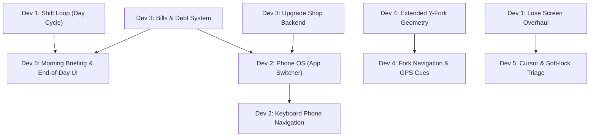

# Sprint 02 – Daily Shift Loop, Y-Junctions & Courier Life System

> **Sprint Goal:** Expand the courier simulation with a persistent "Working Day / Shift" meta-loop. The player progresses through working days, navigating their phone using full keyboard controls to pay mandatory daily living expenses (funny real-life courier debts) and purchase car/driver upgrades from the Courier Shop. Road intersections evolve from abrupt 90° turns into longer, smoother Y-fork junctions. The lose screen is overhauled into an authentic towing/failure screen, and previous soft-locks/cursor bugs are resolved.

---

## 👥 Team Composition & Responsibilities

| Role | Developer | Primary Sprint Responsibility |
|:---|:---|:---|
| **Dev 1** | Game Flow & Fail State | Implement the Daily Shift state loop (`DayBriefing` → `ShiftActive` → `DayEndSummary`) and overhaul the delivery failure/lose screen with towing fees and soft-lock fixes. |
| **Dev 2** | Phone OS & Keyboard Navigation | Build the phone's multi-app Home Screen (Courier App, Shop, Bills) and implement full keyboard/gamepad navigation (`WASD`/Arrows, `Enter`, `ESC`) across all phone UI views. |
| **Dev 3** | Courier Economy, Bills & Upgrades | Implement mandatory daily life expenses (apartment rent, funny parking fines, subscriptions) and create the Courier Upgrade Shop (phone holder, energy drink, bumper armor). |
| **Dev 4** | Road Network – Y-Junctions & Fork Navigation | Replace the short, abrupt 90° turn chunks with extended Y-fork road chunks (~80–90m) and update `TurnTrigger`/GPS routing for smooth highway/avenue branching. |
| **Dev 5** | Shift Briefings, Reports & Bugfix Triage | Build the morning dispatcher briefing and end-of-day financial settlement screen; resolve cursor lock/unlock and stability bugs across the codebase. |

---

## 🔗 Task Dependency Matrix

---

## 📋 Detailed Trello Card Breakdown

---

### 👤 DEV 1 – Game Flow & Fail State

#### 🏷️ Card 1.1: Working Day & Shift Lifecycle Controller
**Description:**
Expand `GameManager` and `GameState` to introduce a higher-level "Working Day / Shift" loop on top of individual deliveries. A work shift consists of a day number (Day 1, Day 2...), a target quota of deliveries (e.g. 3 completed orders to finish the day), and transitions between Morning Briefing, Active Deliveries, and End-of-Day Settlement.

**Key Files:**
`Assets/_Game/Scripts/Core/GameManager.cs`
`Assets/_Game/Scripts/Core/GameState.cs`
`Assets/_Game/Scripts/Core/ShiftManager.cs`

**Checklist:**
- [ ] Add `DayBriefing`, `ShiftActive`, and `DaySummary` states to `GameState.cs`
- [ ] Create `ShiftManager.cs` tracking current day index, deliveries completed today, and target shift quota
- [ ] Allow completing an order to increment the daily delivery tally and check if the shift is done
- [ ] Add option to end the working day early or automatically trigger `DaySummary` when quota is met
- [ ] Persist current day index and total career shifts in `PlayerPrefs`
- [ ] Expose C# events `OnShiftStarted`, `OnShiftCompleted`, and `OnDayAdvanced`

**Definition of Done:**
Game can transition from a new day start, through multiple consecutive deliveries without scene reloading, into an end-of-day state when the quota is reached.

---

#### 🏷️ Card 1.2: Overhaul Delivery Failed & Towing Lose Screen
**Description:**
Replace the legacy endless-runner `GameOverPanel` ("You managed to scroll for X meters") with an authentic, courier-themed Delivery Failed screen. The screen must clearly display the failure cause (Car Totaled vs. Time Expired), compute towing and vehicle repair fees deducted from the wallet, and offer a clean, soft-lock-free return to the garage/lobby.

**Key Files:**
`Assets/_Game/Scripts/UI/DeliveryFailedUI.cs`
`Assets/_Game/Scripts/UI/GameUIController.cs`
`Assets/_Game/Prefabs/UI/DeliveryFailedCanvas.prefab`
`Assets/_Game/Scripts/Core/GameManager.cs`

**Checklist:**
- [ ] Create `DeliveryFailedUI.cs` with animated fade-in and failure cause headline
- [ ] Display towing fee penalty (-25.00 € on crash, -10.00 € on time expiry) deducted via `WalletManager`
- [ ] Show humorous dispatcher reprimand text matching the cause of failure
- [ ] Add "Call Tow Truck & Return to Car" button with keyboard shortcut (`Space` or `Enter`)
- [ ] Safely unlock and show cursor upon failure to prevent interaction soft-locks
- [ ] Completely decouple and deprecate the old endless-runner `GameOverPanel` in `GameUIController`

**Definition of Done:**
When car HP hits 0 or time runs out, the new Delivery Failed panel cleanly appears, applies towing fees, and clicking return resets the car and camera smoothly back to the parked lobby.

---

### 👤 DEV 2 – Phone OS & Keyboard Navigation

#### 🏷️ Card 2.1: Phone Keyboard & Gamepad Navigation System
**Description:**
Enable full keyboard navigation for the smartphone UI so the player is not forced to use the mouse cursor in the 3D cockpit. Players can browse available orders, switch apps, and accept deliveries using `W`/`S` or Arrow keys, confirm with `Enter`/`Space`, and go back with `ESC`/`Backspace`.

**Key Files:**
`Assets/_Game/Scripts/Phone/PhoneInputNavigator.cs`
`Assets/_Game/Scripts/Phone/CourierAppUI.cs`
`Assets/_Game/Scripts/Phone/OrderCardView.cs`

**Checklist:**
- [ ] Create `PhoneInputNavigator.cs` listening to New Input System UI / navigation actions
- [ ] Support `W`/`S` and `Up`/`Down` arrows to change active selection index between order cards
- [ ] Add visible focus highlight state (glowing border or slight scale bounce) on the currently selected card
- [ ] Map `Enter` and `Space` to trigger the "Accept Order" action on the highlighted card
- [ ] Map `ESC` or `Backspace` to return to the phone's Home Screen
- [ ] Ensure mouse hover and keyboard navigation do not conflict or desync

**Definition of Done:**
In `OrderSelection` lobby, the player can select and accept any of the 3 orders using strictly keyboard arrows and Enter without touching the mouse.

---

#### 🏷️ Card 2.2: Phone Operating System & Multi-App Home Hub
**Description:**
Upgrade the courier phone screen from a single static list into a simulated smartphone OS ("DoomOS") with a Home Screen and app icons. The driver can switch between three main apps: **Bolt Courier** (Orders), **KurierShop** (Upgrades), and **Bills & Debt** (Daily Expenses).

**Key Files:**
`Assets/_Game/Scripts/Phone/PhoneOSController.cs`
`Assets/_Game/Scripts/Phone/HomeScreenUI.cs`
`Assets/_Game/Prefabs/Phone/PhoneOSCanvas.prefab`

**Checklist:**
- [ ] Create `PhoneOSController.cs` managing active app states (`Home`, `CourierApp`, `ShopApp`, `BillsApp`)
- [ ] Build a Home Screen view with 3 clickable/selectable app icons, battery indicator, and time display
- [ ] Implement smooth screen transitions (slide/fade) when opening and closing apps
- [ ] Add a bottom "Home Bar" or back button to quickly return to Home Screen
- [ ] Preserve existing order generation in `CourierAppUI` when navigating back and forth between apps
- [ ] Connect with `PhoneInputNavigator` so apps can be launched via keyboard selection

**Definition of Done:**
Player in lobby can exit the courier app to Home Screen, open the Bills or Shop app, and return back to Courier app seamlessly without breaking order data.

---

### 👤 DEV 3 – Courier Economy, Bills & Upgrades

#### 🏷️ Card 3.1: Mandatory Daily Bills & Living Expenses System
**Description:**
Implement the financial pressure of being an everyday courier driver through a humorous "Bills & Debts" system. Every working day, fixed expenses (apartment rent, funny parking tickets, energy drink subscriptions, clunker car payments) must be settled from the player's wallet.

**Key Files:**
`Assets/_Game/Scripts/Economy/BillsManager.cs`
`Assets/_Game/Scripts/Economy/BillItem.cs`
`Assets/_Game/Scripts/Phone/BillsAppUI.cs`

**Checklist:**
- [ ] Create `BillItem.cs` data structure (Title, Cost, Description, Humorous Category, DueDay)
- [ ] Build `BillsManager.cs` generating daily expenses (e.g. "Studio Apartment Rent - 40€", "Sidewalk Parking Fine - 25€", "Energy Drink Subscription - 10€", "1998 Clunker Loan - 15€")
- [ ] Create `BillsAppUI.cs` for the phone screen displaying list of pending bills and total daily debt
- [ ] Add "Pay All" and individual "Pay Bill" buttons connected to `WalletManager`
- [ ] Trigger warning notifications on the phone if the player lacks funds for today's mandatory rent
- [ ] Hook into `ShiftManager` so unpaid bills accumulate interest or trigger repo warnings

**Definition of Done:**
The Bills app on the phone accurately lists daily living costs, allows the player to pay them from their wallet balance, and updates wallet persistence.

---

#### 🏷️ Card 3.2: Courier Upgrade Shop (Funny & Functional Upgrades)
**Description:**
Create an upgrade store where couriers spend hard-earned tip money on upgrades that mitigate road hazards and FOMO distractions, mixed with funny cosmetic car decorations.

**Key Files:**
`Assets/_Game/Scripts/Economy/UpgradeManager.cs`
`Assets/_Game/Scripts/Economy/CourierUpgradeItem.cs`
`Assets/_Game/Scripts/Phone/ShopAppUI.cs`

**Checklist:**
- [ ] Create `CourierUpgradeItem.cs` (Name, Price, Icon, UpgradeType, IsPurchased)
- [ ] Implement functional upgrades:
  - Phone Mount (reduces camera shake when scrolling in lobby / driving)
  - Caffeinated Hell Energy Shot (slows FOMO drain rate by 25% for 1 shift)
  - Reinforced Bumper Armor (vehicle absorbs 1 extra collision before smoking)
- [ ] Implement funny cosmetic upgrades (Coconut Tree air freshener on mirror, Racing stripes sticker)
- [ ] Build `ShopAppUI.cs` on the phone screen with "Buy" buttons that deduct funds via `WalletManager`
- [ ] Apply active upgrade modifiers dynamically inside `PhoneSystem.cs` and `VehicleHealth.cs`
- [ ] Save purchased upgrades in `PlayerPrefs`

**Definition of Done:**
Player can open the Shop app on their phone, purchase an upgrade with sufficient funds, and observe the gameplay effect (e.g. reduced FOMO drain or extra collision buffer) during the next delivery.

---

### 👤 DEV 4 – Road Evolution: Y-Junctions & Fork Road Network

#### 🏷️ Card 4.1: Extended Y-Fork Road Prefabs & Branch Geometry
**Description:**
The original 44.75m 90° T-junctions feel too short and abrupt at courier driving speeds. Design and implement an extended Y-junction / fork road segment (~80–90m length) where the highway splits smoothly into two branching lanes (left fork vs. right fork), complete with guardrails and divider islands.

**Key Files:**
`Assets/_Game/Prefabs/Environment/RoadChunk_YFork.prefab`
`Assets/_Game/Scripts/Environment/RoadChunk.cs`
`Assets/_Game/Scripts/Environment/EnvironmentSpawner.cs`

**Checklist:**
- [x] Model/assemble extended Y-fork road chunk (~85m length) with gradual lane separation
- [x] Add central divider barrier / crash attenuator between left and right branches
- [x] Update `RoadChunk.cs` to support `RoadChunkType.YFork` with dual exit anchors
- [x] Configure `EnvironmentSpawner.cs` to support seamlessly spawning and aligning preview chunks to both fork exits
- [x] Ensure building models and streetlights frame the fork naturally without visual gaps or pop-in
- [x] Verify chunk mesh colliders and road surface textures match the existing asphalt style

**Definition of Done:**
The spawner can place an 85m Y-fork chunk in the world; the road visually splits into two distinct paths with no geometry tears or missing textures.

---

#### 🏷️ Card 4.2: Fork Navigation, Steering Splitting & Recalculating
**Description:**
Adapt `TurnTrigger` and `RouteController` to evaluate smooth lateral positioning as the player steers down either the left or right fork of the Y-junction, updating the dashboard GPS with clear fork guidance ("Keep Left / Keep Right").

**Key Files:**
`Assets/_Game/Scripts/Navigation/TurnTrigger.cs`
`Assets/_Game/Scripts/Navigation/RouteController.cs`
`Assets/_Game/Scripts/Navigation/DashboardNavigationSource.cs`

**Checklist:**
- [x] Update `TurnTrigger.cs` to support an elongated trigger zone along the fork corridor
- [x] Evaluate lane choice based on car X coordinate as the divider island approaches
- [x] Add `Maneuver.ForkLeft` and `Maneuver.ForkRight` to `DashboardNavigationSource`
- [x] Display fork arrows on the dashboard GPS and trigger voice cue ("Take the left fork")
- [x] If the player enters the wrong fork or hits the crash barrier, trigger **Recalculating** (+route extension and penalty)
- [x] Smoothly pivot and align the chosen fork branch into the main forward driving axis

**Definition of Done:**
Approaching the Y-fork, the GPS announces which fork to take; steering into the correct fork continues the delivery seamlessly; entering the wrong fork triggers Recalculating and penalty.

---

### 👤 DEV 5 – Shift Briefings, Reports & Bugfix Triage

#### 🏷️ Card 5.1: Morning Dispatcher Briefing & End-of-Day Report UI
**Description:**
Create immersive narrative bookends for each working day. Before the first delivery of the shift, display a humorous "Morning Briefing" from courier dispatch. At the end of the shift, present a full "End-of-Day Financial Report" detailing earnings, deductions for daily bills, and net savings.

**Key Files:**
`Assets/_Game/Scripts/UI/ShiftBriefingUI.cs`
`Assets/_Game/Scripts/UI/ShiftSummaryUI.cs`
`Assets/_Game/Prefabs/UI/ShiftReportCanvas.prefab`

**Checklist:**
- [ ] Create `ShiftBriefingUI.cs` appearing on the phone screen at the start of a shift
- [ ] Display procedural dispatcher messages (e.g. "Rainy Tuesday: Pizza orders are up 40%, watch out for speed cameras!")
- [ ] Show today's target quota and total bills due
- [ ] Create `ShiftSummaryUI.cs` appearing when the day's quota is completed:
  - Gross delivery earnings
  - Total speed tips earned
  - Vehicle damage repairs
  - Mandatory bills deducted
  - Net bank account change
- [ ] Add "Clock Out & Sleep" button advancing the calendar to the next day and resetting to morning lobby

**Definition of Done:**
Starting a shift shows the briefing; finishing daily orders transitions to the Shift Summary screen, deducts bills, and successfully advances to Day 2.

---

#### 🏷️ Card 5.2: Bugfix & Stability Triage (Soft-locks, Cursor State, Collisions)
**Description:**
Resolve accumulated edge-case bugs and UI interaction issues reported from Sprint 01 playtesting, with special focus on mouse cursor locking/unlocking, collision bounce physics, and audio state leakage.

**Key Files:**
`Assets/_Game/Scripts/Core/PauseController.cs`
`Assets/_Game/Scripts/Player/VehicleCollisionHandler.cs`
`Assets/_Game/Scripts/Player/VehicleAudio.cs`
`Assets/_Game/Scripts/UI/DeliverySummaryUI.cs`

**Checklist:**
- [ ] Fix cursor lock/visibility state across all transitions:
  - Locked & hidden during `DeliveryActive`
  - Unlocked & visible in `OrderSelection`, `DeliveryCompleted`, `DeliveryFailed`, and Pause
- [ ] Fix soft-lock when pressing `ESC` during delivery summary tally animation
- [ ] Prevent tire screech audio loop from sticking on when car hits obstacles at zero speed
- [ ] Clamp high-speed curb bounces in `VehicleCollisionHandler` to prevent camera clipping through car roof
- [ ] Eliminate duplicate `AudioListener` or `PhoneSystem` warnings on scene boot
- [ ] Verify clean garbage collection and unsubscribed events when exiting play mode

**Definition of Done:**
10 consecutive delivery runs with pause toggles, crashes, and menu switches run smoothly without cursor locks, audio bugs, or console errors.

---

## 🛠️ Extra Bugfix & Polishing Pool (For whoever has capacity)
These cards are unassigned and open to any team member who completes their primary sprint cards early:

- **Polish Card A – Dashboard Speedometer & Fuel Gauge:** Add visual needle movement to the 3D car cockpit instrument cluster reflecting actual `WorldMover.moveSpeed`.
- **Polish Card B – Weather Variation (Rain & Fog):** ✅ Completed on `alternating-weather` — added exterior rain particles, rain-on-glass shader on car windshield & side windows, automatic windshield wipers, wet road reflections, and daily shift briefing fog density control (see [`Dynamic_Weather_and_Wipers.md`](./Dynamic_Weather_and_Wipers.md)).
- **Polish Card C – Radio Station Switcher:** Add a clickable knob on the dashboard radio to switch between 2-3 funny city radio stations or car silence.

