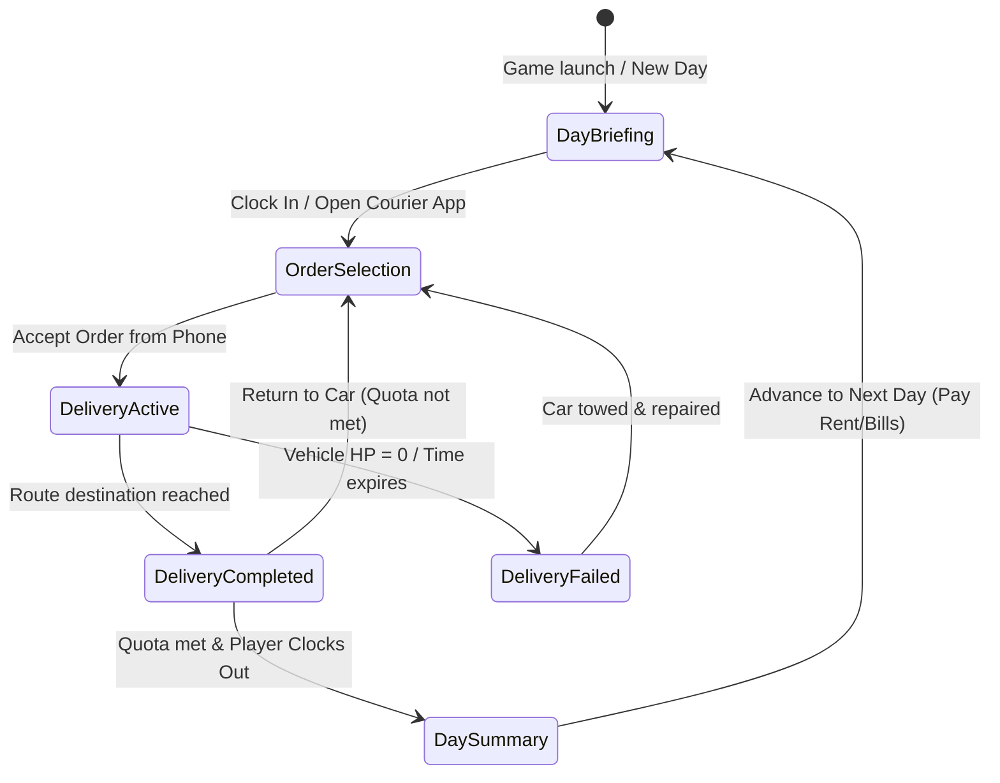

# DoomDriver – Workday & Shift Lifecycle Architecture Guide

> **Target Audience:** AI Agents & Developers working on DoomDriver (Sprint 02+).  
> **Purpose:** Comprehensive technical manual and architectural handover documenting the Workday & Shift Lifecycle system: its state machines, backend managers, event bus, phone UI contracts, Figma mockups, and best practices for implementation.

---

## 1. High-Level Concept & Gameplay Loop

DoomDriver expands from single disconnected delivery runs into a cohesive **Courier Career Simulation (Sprint 02)**. The player experiences an authentic courier workday lifecycle:



### The 3 Layers of the Workday:
1. **Morning Dispatch (`DayBriefing`):**
   * The driver sits in the parked car at the start of the day.
   * Review today's minimum quota (e.g. 3 deliveries required), daily living bills due tonight (e.g. € 25.00), and overtime incentives (+25% speed tip per extra order).
   * Clock in and start the shift by opening the Courier App (`Quick-Bite`).
2. **Active Shift (`OrderSelection` ↔ `DeliveryActive`):**
   * Player selects delivery offers from the Courier App based on difficulty, reward, and distance.
   * Drives through the city with smooth steering, Y-junction forks, GPS turn cues, and FOMO video distraction on the phone.
   * Completed deliveries increment `DeliveriesCompletedToday` and add payouts to `ShiftEarnings`.
   * Hitting quota unlocks **Overtime Mode** (bonus tips on all subsequent runs).
   * Player can choose to clock out early or keep grinding overtime.
3. **End-of-Day Settlement (`DaySummary`):**
   * Shift ends (either automatically when clocking out, or from the menu).
   * Net settlement receipt: `Gross Shift Pay` – `Daily Living Bills / Rent` = `Net Profit`.
   * Wallet balance updates, player presses "Start Next Day", and day index advances (`Day 1 → Day 2`).

---

## 2. Architecture & File Directory

All lifecycle code is organized under `Assets/_Game/Scripts/`:

```
Assets/_Game/
├── Scripts/
│   ├── Core/
│   │   ├── GameManager.cs          # Central game state machine controller
│   │   ├── GameState.cs            # Enum: DayBriefing, OrderSelection, DeliveryActive, DaySummary...
│   │   ├── ShiftManager.cs         # Core singleton managing shifts, quotas, days, earnings
│   │   └── WorldSpeedController.cs # World mover speed resets
│   ├── Economy/
│   │   ├── DeliveryOrder.cs        # Order data model (payout, distance, time limit)
│   │   ├── OrderManager.cs         # Generates restaurant delivery offers
│   │   └── WalletManager.cs        # Player persistent balance & currency transactions
│   ├── Phone/
│   │   ├── PhoneOSController.cs    # Phone OS navigation, screen switcher (Home, Apps)
│   │   ├── PhoneInputNavigator.cs  # Keyboard navigation (WASD/Arrows, Enter, Space, ESC)
│   │   ├── AppIconView.cs          # Interactive app icon view on Home Screen
│   │   ├── CourierAppUI.cs         # Order card selection container
│   │   ├── ShiftCardWidget.cs      # Reusable UI component for the 3 shift lifecycle states
│   │   └── DailyGoalWidget.cs      # Simple progress bar widget reacting to balance/quotas
│   └── _Tests/
│       └── ShiftManagerDemo.cs     # Automated test suite verifying shift logic & rollover
├── Prefabs/Phone/
│   └── PhoneOSCanvas.prefab        # World Space canvas prefab on the in-game phone
└── Textures/ImageIcons/
    ├── scooter.png                 # Quick-Bite Courier icon
    ├── wrench.png                  # Doom Garage Shop icon
    ├── piggy.png                   # DoomBank Bills icon
    └── fire.png                    # DoomTok FOMO Reels icon
```

---

## 3. Core Backend: `ShiftManager.cs`

`ShiftManager` is the single source of truth for shift progress and day progression.

### Class Definition (`DoomDriver.Core.ShiftManager`):
* **Pattern:** MonoBehaviour Singleton (`ShiftManager.Instance`).
* **Persistence:** Preserves career stats (`CurrentDay`, `CareerShiftsCompleted`) across sessions via `PlayerPrefs`.

### Key Properties:
| Property | Type | Description |
| :--- | :--- | :--- |
| `CurrentDay` | `int` | Current day number (1, 2, 3...). Persisted in PlayerPrefs. |
| `DailyQuota` | `int` | Minimum deliveries required today (base: 3, scales by +1 every 3 days, max 8). |
| `DeliveriesCompletedToday`| `int` | Count of successful orders delivered during the current shift. |
| `ShiftEarnings` | `float` | Cumulative gross payout earned during the current shift. |
| `DailyBills` | `float` | Fixed daily living expenses/rent due at end of day (default: € 25.00). |
| `IsShiftActive` | `bool` | True while the player is clocked in and working. |
| `IsQuotaMet` | `bool` | True if `DeliveriesCompletedToday >= DailyQuota`. |
| `IsShiftFinished` | `bool` | True when the shift has ended and DaySummary is ready. |

### Public API Methods:
```csharp
// Starts the daily work shift (clocks in, unlocks Courier App)
public void StartShift();

// Records a successful delivery, adds earnings, checks quota
public void RecordDelivery(float payoutEarned);

// Clocks out and concludes the active shift (triggers DaySummary)
public void EndShift();

// Deducts daily bills, settles net income, increments CurrentDay
public void AdvanceToNextDay();

// Resets entire career back to Day 1 (for testing / restart)
public void ResetRun();
```

### Event Bus (C# Events):
```csharp
public static event System.Action OnShiftStarted;
public static event System.Action<int, int> OnDeliveryCountChanged; // (delivered, quota)
public static event System.Action<int> OnDayAdvanced;              // (newDay)
```

---

## 4. Integration with `GameManager.cs`

`GameManager` drives the macroscopic game loop. In `CompleteDelivery()`, `GameManager` automatically reports the order payout to `ShiftManager`:

```csharp
// Inside GameManager.cs
if (ShiftManager.Instance != null && activeOrder != null)
{
    ShiftManager.Instance.RecordDelivery(finalPayout);
}
```

### State Transitions:
1. `DayBriefing` → Player opens Courier app or clicks "Clock In" → `GameManager.Instance.TransitionFromBriefingToShift()` → transitions to `OrderSelection`.
2. `OrderSelection` → Player accepts an order offer → `GameManager.Instance.StartDelivery(selectedOrder)` → transitions to `DeliveryActive`.
3. `DeliveryActive` → Destination reached → `GameManager.Instance.CompleteDelivery()` → transitions to `DeliveryCompleted`.
4. `DeliveryCompleted` → Player presses continue (`R`) → returns to `OrderSelection`.
5. Clock Out / Quota Complete → `ShiftManager.Instance.EndShift()` → triggers `DaySummary`.
6. `DaySummary` → Player clicks "Next Day" → `ShiftManager.Instance.AdvanceToNextDay()` → resets shift tally and transitions to `DayBriefing`.

---

## 5. Phone UI: Current State & Design Targets

### A. Current Branch State (Clean Baseline)
* The in-game phone UI (`PhoneOSCanvas.prefab`) has been reverted to the pristine branch state.
* In the lobby, the phone opens directly into `CourierApp` (`OpenScreen(PhoneScreen.CourierApp)`), allowing immediate order card selection.
* Header text (`DateText`) updates dynamically via `PhoneOSController.RefreshHomeScreenShiftInfo()` to display `DAY X • GOAL: Y/Z ORDERS`.
* No procedural hierarchy overrides are injected at runtime, ensuring zero layout bugs or overlapping text.

### B. Figma Design Reference
The target UI design has been provided by the team and is stored in the repository:
* **Figma Make File:** [`Figma/Courier_App_Workday_Lifecycle.make`](file:///c:/Users/jakub/OneDrive/Počítač/2627/TP/DoomDriver/Figma/Courier_App_Workday_Lifecycle.make)
* **Interactive HTML Prototype:** [`Figma/preview_workday_lifecycle.html`](file:///c:/Users/jakub/OneDrive/Počítač/2627/TP/DoomDriver/Figma/preview_workday_lifecycle.html)

### C. Color Palette & Typography Tokens:
* **Screen Background:** Cream `#FEF7ED` (Warm, pleasant mobile background).
* **Card & Text Navy:** `#1E1B4B` (High-contrast, bold outlines and titles).
* **Mint Green (Success / Active):**
  * Background: `#D1FAE5`
  * Dark text: `#065F46`
  * Action button: `#34D399` with shadow `#059669`.
* **Lavender (DoomTok):** `#E0E7FF` (Subtle purple card background).
* **Soft Red (Clock Out / Danger):**
  * Background: `#FEE2E2`
  * Outline: `#B91C1C`
  * Text: `#991B1B`.
* **Amber (Overtime):**
  * Background: `#FEF3C7`
  * Text: `#92400E`
  * Fill: `#F59E0B`.

---

## 6. How to Implement the UI in Unity (Guidelines for the Agent)

When creating or modifying the phone UI prefabs in Unity:

> [!IMPORTANT]
> **Do NOT construct or reposition UI hierarchies procedurally via script at runtime.**  
> Procedural RectTransform manipulation often conflicts with Unity's `LayoutGroup` engines, leading to overlapping text, crushed heights, or broken child anchors.

### Best Practice Procedure:
1. **Prefab-First Authoring:**
   * Open `Assets/_Game/Prefabs/Phone/PhoneOSCanvas.prefab` in Unity Editor.
   * Edit UI hierarchy visually inside the editor using standard Anchors and RectTransforms.
   * The canvas dimensions are **500 px width × 1000 px height** (World Space Canvas).
2. **Dedicated Widgets (`ShiftCardWidget.cs`):**
   * Use [`Assets/_Game/Scripts/Phone/ShiftCardWidget.cs`](file:///c:/Users/jakub/OneDrive/Počítač/2627/TP/DoomDriver/Assets/_Game/Scripts/Phone/ShiftCardWidget.cs) as a component attached directly to a card GameObject on the canvas.
   * Wire the serialized fields (`[SerializeField] private TMP_Text statusPillText`, `[SerializeField] private Button startShiftButton`, etc.) in the Inspector.
   * The widget subscribes cleanly to `ShiftManager` events and automatically toggles between `briefingContainer`, `activeContainer`, and `summaryContainer`.
3. **App Icons Grid (`AppsGrid`):**
   * Keep the 2×2 grid layout:
     1. **Quick-Bite** (`PhoneScreen.CourierApp`): Mint card `#D1FAE5`, scooter icon.
     2. **Doom Garage** (`PhoneScreen.ShopApp`): Yellow card `#FEF08A`, wrench icon.
     3. **DoomBank** (`PhoneScreen.BillsApp`): Pink card `#FCE7F3`, piggy bank icon.
     4. **DoomTok** (`PhoneScreen.DoomTok`): Lavender card `#E0E7FF`, fire flame icon (`Assets/_Game/Textures/ImageIcons/fire.png`).
4. **DoomTok Screen Panel (`DoomTokAppPanel`):**
   * Add a fullscreen panel under `PhoneOSCanvas`.
   * Add a `TopBar` with a Back Arrow Button that invokes `PhoneOSController.Instance.ReturnToHomeScreen()`.
   * Add a `RawImage` displaying `PhoneScreenRT.renderTexture` so the player can watch the FOMO reels video stream directly inside the app.

---

## 7. Testing & Verification

An automated verification test script is included in the project:
* **Script:** [`Assets/_Game/Scripts/_Tests/ShiftManagerDemo.cs`](file:///c:/Users/jakub/OneDrive/Počítač/2627/TP/DoomDriver/Assets/_Game/Scripts/_Tests/ShiftManagerDemo.cs)

### Key Test Cases Covered:
1. **`TestShiftLifecycle`:** Validates Day 1 start, quota tracking (1/3, 2/3, 3/3), overtime unlocking, and day advancement.
2. **`TestQuotaProgression`:** Verifies that quotas dynamically scale as days advance (Day 1: 3 orders, Day 4: 4 orders, Day 7: 5 orders).
3. **`TestBillsDeduction`:** Validates net profit calculation (`ShiftEarnings - DailyBills`) and proper deduction from `WalletManager`.
4. **`TestPersistence`:** Verifies that saving and loading from `PlayerPrefs` correctly restores current day index and career shifts.

### Running the Tests:
In the Unity Editor, open the test scene or attach `ShiftManagerDemo.cs` to a GameObject and check the Unity Console for `[ShiftManagerDemo] ALL TESTS PASSED!`.
